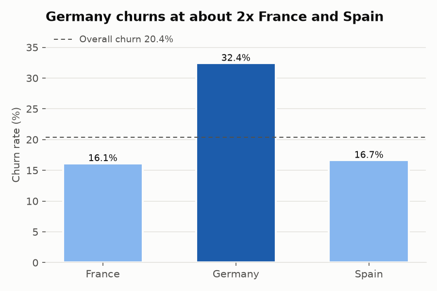
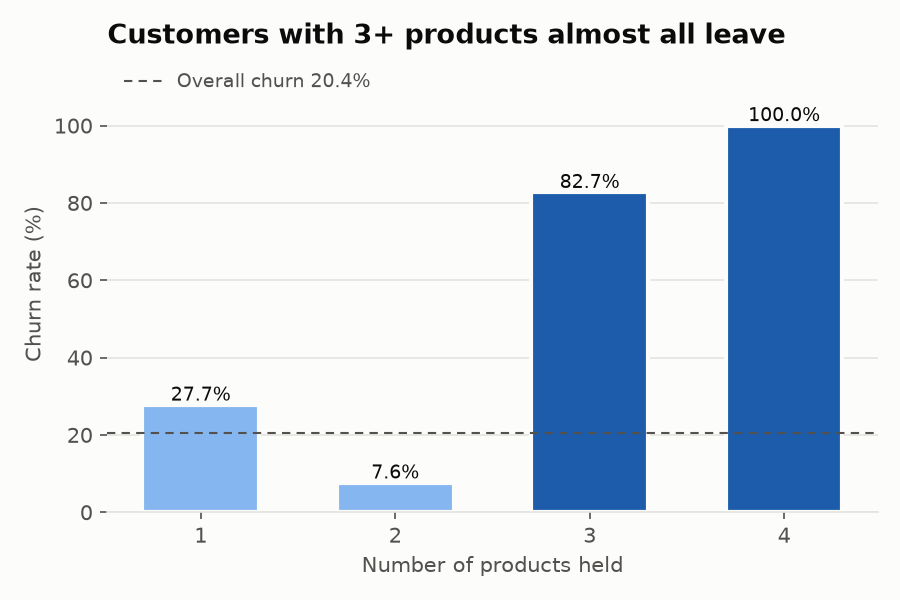
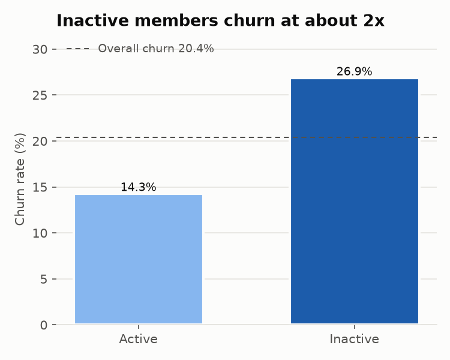
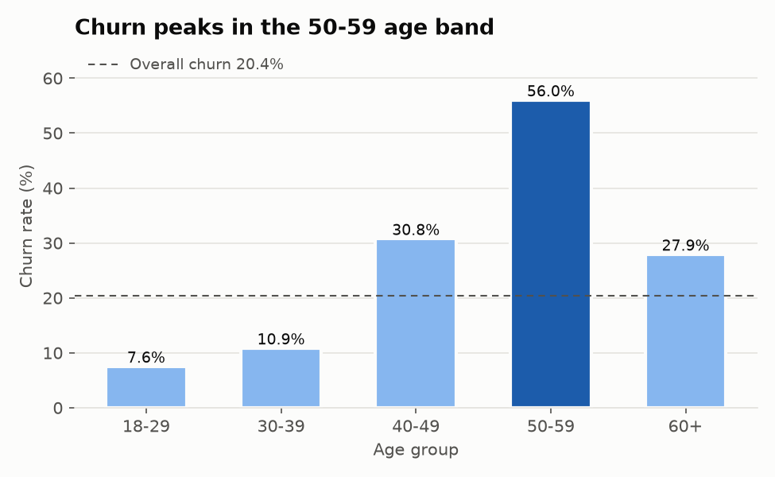
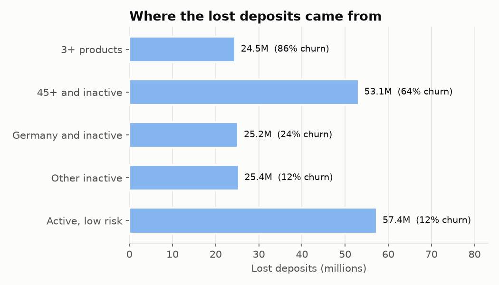

# Bank Customer Churn Analysis

An end-to-end analysis of why customers leave a retail bank: a tested Python ETL pipeline loads 10,000 customer records into SQLite, and 12 SQL queries break churn down by segment to find the drivers and size the deposits lost.

**Stack:** Python, pandas, SQLite, SQL (CTEs, window functions), pytest, Matplotlib, Seaborn

## Key findings

| Finding | Number |
|---|---|
| Overall churn | **20.4%** (2,037 of 10,000 customers) |
| Deposits lost with churned customers | **185.6M** (24.3% of all deposits) |
| Germany churn vs France / Spain | **32.4%** vs 16.2% / 16.7% (Germany alone is 52.8% of lost deposits) |
| Inactive vs active members | **26.9%** vs 14.3% (about 1.9x) |
| Customers holding 3+ products | **82.7%** churn at 3 products, **100%** at 4 |
| Age 50-59 | **56.0%** churn, the highest of any age band |
| Credit score | Almost no signal: every decile sits between 17.6% and 22.6% |







### What a bank would do with this
1. **Stop pushing a 3rd product.** Two products is the sweet spot (7.6% churn). Cross-selling beyond that appears to drive customers away.
2. **Re-engage inactive members aged 45+.** This segment churns at 64% and accounts for 53.1M of lost deposits, the largest single bucket after the broad low-risk base.
3. **Investigate Germany.** Same products, twice the churn, and more than half of all lost money. Likely a competitive or service issue specific to that market.

## Project structure

```
bank-churn/
├── data/
│   ├── raw/Churn_Modelling.csv   # source data (10,000 rows)
│   └── churn.db                  # SQLite output of the ETL (generated)
├── src/
│   ├── etl.py                    # extract -> clean -> feature engineer -> load
│   └── run_analysis.py           # runs the 12 queries, saves CSVs + charts
├── sql/analysis.sql              # the 12 analysis queries
├── tests/test_etl.py             # 14 pytest unit tests for the transforms
├── results/                      # one CSV per query (generated)
└── charts/                       # PNG charts (generated)
```

## How to run

```bash
pip install -r requirements.txt
python -m src.etl              # builds data/churn.db
python -m pytest -v            # 14 tests
python -m src.run_analysis     # runs all 12 queries, writes results/ and charts/
```

## ETL pipeline (`src/etl.py`)

**Extract:** reads the CSV and fails fast if any expected column is missing.

**Clean:**
- Drops `RowNumber` (index artifact) and `Surname` (PII, no analytic value)
- Strips and title-cases categorical text (`" germany "` -> `"Germany"`)
- Drops rows with no `CustomerId` or target, and duplicate customer IDs
- Imputes missing numeric values with the median, binary/categorical with the mode
- Enforces types and drops records outside valid ranges (credit score 300-900, age 18-100, etc.)

**Feature engineering:**
- Segments: `AgeGroup`, `CreditBand`, `TenureGroup`
- Flags and ratios: `ZeroBalance`, `MultiProduct` (3+), `BalanceSalaryRatio`, `ProductsPerTenure`
- Encoding: binary `GenderMale`, one-hot `Geo_France` / `Geo_Germany` / `Geo_Spain`

**Load:** writes to SQLite, adds indexes on `Geography` and `Exited`, and verifies the loaded row count matches the dataframe.

## Tests (`tests/test_etl.py`)

14 tests run against a small hand-built frame containing a duplicate ID, NaNs, messy text and an out-of-range credit score:
- **Missing values:** no NaNs survive; numeric NaNs get the median
- **Encoding:** gender is 0/1; geography one-hot columns sum to exactly 1 per row
- **Row counts:** 6 raw rows -> 4 clean rows (1 duplicate, 1 invalid); SQLite count equals dataframe count
- **Feature logic:** age bins, zero-balance flag, ratio is finite when salary is 0
- One integration test confirms all 10,000 real rows survive the pipeline with no nulls

## The 12 queries (`sql/analysis.sql`)

| # | Query | Techniques |
|---|---|---|
| 01 | Overall churn and lost deposits | CASE aggregation |
| 02 | Churn by geography | CTE, `RANK()`, `SUM() OVER ()` share |
| 03 | Active vs inactive | CTE, `MIN() OVER ()` multiple |
| 04 | Churn by number of products | CASE risk label |
| 05 | Churn by age group | CTE, `LAG()` |
| 06 | Balance quartiles | `NTILE(4)`, `UNION ALL` |
| 07 | Credit score deciles | `NTILE(10)` |
| 08 | Geography x gender | `RANK() OVER (PARTITION BY)`, `AVG() OVER (PARTITION BY)` |
| 09 | Top 5 churned balances per country | `ROW_NUMBER() OVER (PARTITION BY)` |
| 10 | Tenure with running churn share | running `SUM() OVER (ORDER BY)` |
| 11 | Rule-based risk segments | CTE, CASE segmentation, deposits at risk |
| 12 | Churned vs retained profile | CASE, conditional averages |

## Data

[Bank Customer Churn dataset](https://www.kaggle.com/datasets/shrutimechlearn/churn-modelling) (10,000 customers of a European bank, 14 columns). Currency is not specified in the source.
